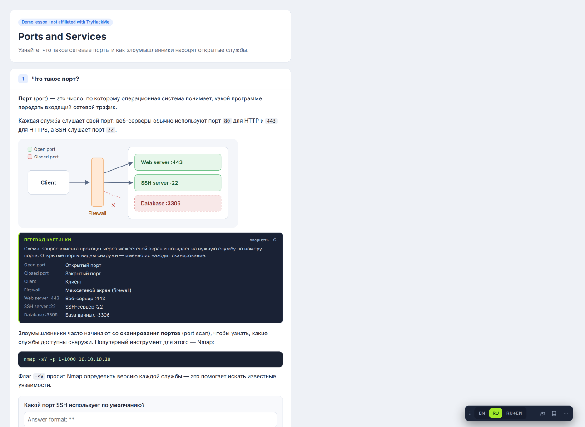
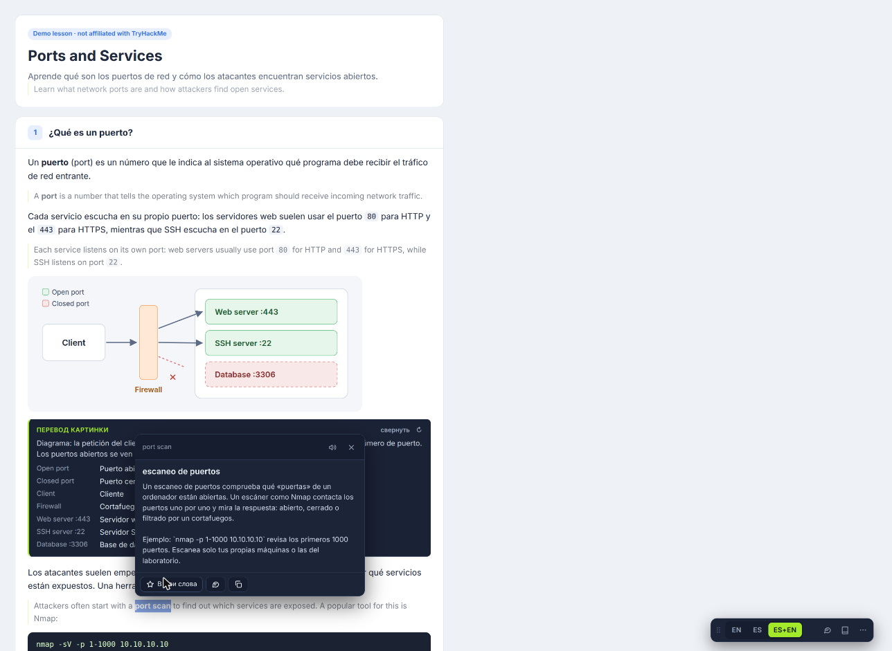
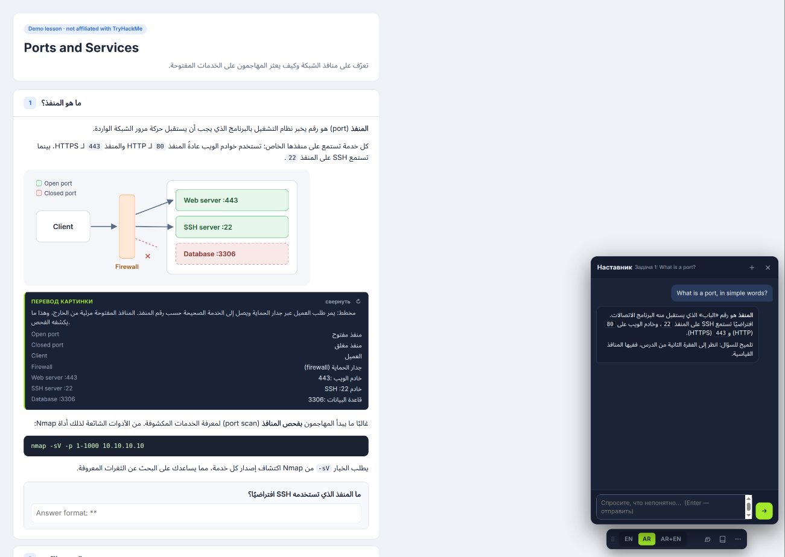
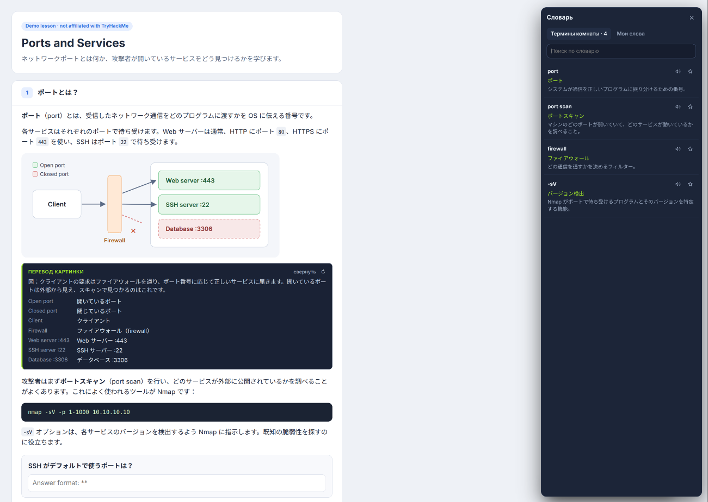
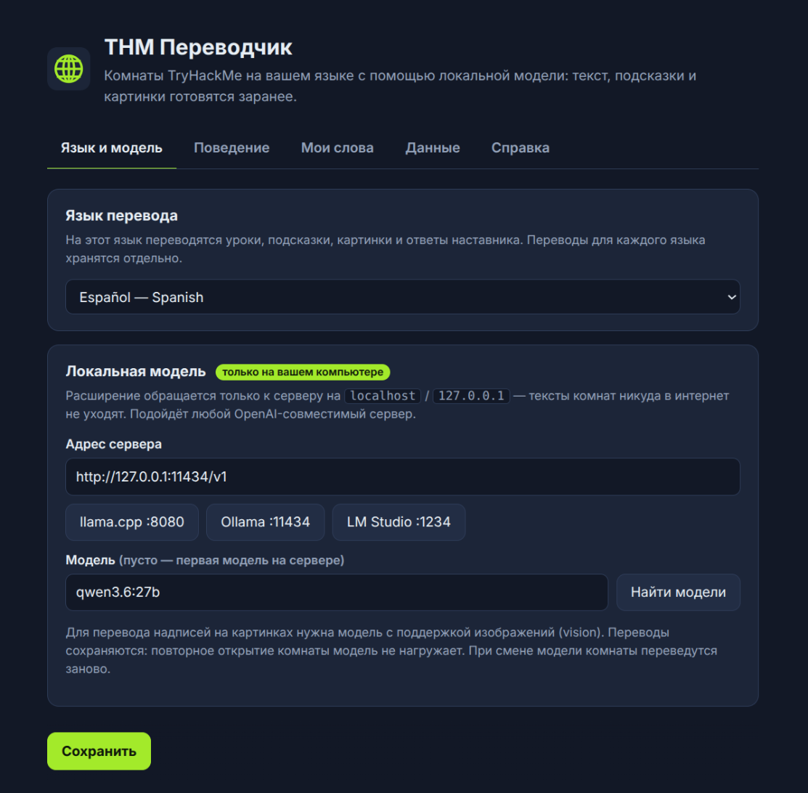

# THM Translator

A Chrome extension that translates [TryHackMe](https://tryhackme.com) rooms into **45 languages** using an AI model that runs **on your own computer**. Lessons, questions, hints and even the text inside images are translated by your local model, so nothing leaves your machine.

**English** · [Русский](README.ru.md)



## Features

- **Whole rooms, not just sentences.** Task text, task titles, questions and hints are translated in place. You can switch between three modes: original, translation, or translation with the original underneath (<kbd>Alt+R</kbd> / <kbd>Alt+B</kbd>).
- **Images.** Text on screenshots and diagrams is read and translated, with a one-line summary of what the picture shows. This needs a vision model.
- **Explain anything you select.** Select a word, phrase or command to get a translation in context and a plain-language explanation. "More" gives a detailed breakdown, and you can save the term to *My words*.
- **Room glossary.** Key terms are collected automatically while translating and reused, so terminology stays consistent across the room.
- **Mentor chat.** A small chat next to the lesson sees the open task and answers in your language. For task questions it gives a hint first, not the answer.
- **45 languages**, including right-to-left scripts (Arabic, Persian, Hebrew, Urdu) and CJK.
- **Prepared in advance.** When you open a room, the whole room is translated in the background, so expanding a task shows the translation instantly. Translations are cached per language: reopening a room costs nothing.

## Local only

This version talks **only to a local model**:

- `host_permissions` are limited to `tryhackme.com` and `localhost` / `127.0.0.1`. There are no cloud APIs, API keys, analytics or external servers in the code.
- Requests go to an OpenAI-compatible `/v1/chat/completions` endpoint on your machine.
- Pronunciation of English terms uses only your system's on-device speech voices.
- Settings are not included in backups.

## Requirements

- Chrome or another Chromium browser (Manifest V3).
- A local OpenAI-compatible server, for example:
  - [llama.cpp](https://github.com/ggml-org/llama.cpp) `llama-server` (default `http://127.0.0.1:8080/v1`)
  - [Ollama](https://ollama.com) (`http://127.0.0.1:11434/v1`)
  - [LM Studio](https://lmstudio.ai) (`http://127.0.0.1:1234/v1`)
- An instruction-tuned model that writes your target language well. Servers that support JSON-schema output (`response_format`) give the most reliable results; if the server rejects it, the extension retries without it automatically. Image translation needs a vision model.

## Install

1. Download this repository (**Code → Download ZIP**, or `git clone`) and unzip it.
2. Open `chrome://extensions`, turn on **Developer mode**, click **Load unpacked** and select the folder.
3. Click the extension icon to open the settings:
   - choose the **translation language**;
   - pick your server (llama.cpp / Ollama / LM Studio presets) and click **Find models**;
   - click **Save**, then **Help → Check connection**.
4. Open any TryHackMe room. The panel appears in the bottom-right corner.

Examples of starting a server:

```sh
# llama.cpp
llama-server -m your-model.gguf --port 8080

# Ollama (if requests are rejected with HTTP 403, allow extension origins)
OLLAMA_ORIGINS="chrome-extension://*" ollama serve
```

## Try it without TryHackMe: the simulator

`demo/` contains a small demo lesson that runs the **real** `content.js` with a fake `chrome.*` API and pre-recorded model answers in Russian, Spanish, Arabic and Japanese. No model and no TryHackMe account are needed.

```sh
python3 -m http.server 8000
# open http://127.0.0.1:8000/demo/
```

Use the buttons in the top bar to explain a term, ask the mentor or open the glossary, and switch languages with the selector.

## Screenshots

All screenshots are taken from the simulator.

| | |
|---|---|
|  |  |
| Select a term → explanation in context (Spanish, translation + original) | Mentor chat in Arabic, right to left |
|  |  |
| Room glossary collected while translating (Japanese) | Settings: language and local server |

## How it works

| File | Role |
|---|---|
| `content.js` | Finds lesson blocks on the TryHackMe page, sends their HTML to the service worker, and inserts translations next to the originals. Originals are hidden, never removed, and translated HTML is sanitized against an allowlist of tags. Also provides the panel, selection popup, glossary and chat UI (Shadow DOM). |
| `background.js` | Builds prompts for the chosen language, calls the local server with a JSON schema, caches results in `chrome.storage.local` per language and model, keeps the room glossary, limits parallel requests to 3, and retries on network errors and 5xx responses. |
| `languages.js` | The list of supported languages, shared by the service worker, the content script and the settings page. |
| `options.html` / `options.js` | Settings: language, local server, behaviour, saved words, cache and backup. |
| `demo/` | The simulator. |

For advance preparation, the extension reads the room's tasks through TryHackMe's own web API in your logged-in session (the same requests the site makes) and translates them in the background, one batch at a time. Optionally it also prepares the next rooms of your learning path.

## Supported languages

Russian, Ukrainian, Spanish, Portuguese (Brazil), Portuguese (Portugal), French, German, Italian, Dutch, Polish, Czech, Romanian, Hungarian, Greek, Swedish, Turkish, Arabic, Persian, Hebrew, Urdu, Hindi, Bengali, Marathi, Tamil, Telugu, Chinese (Simplified), Chinese (Traditional), Japanese, Korean, Vietnamese, Thai, Indonesian, Malay, Filipino, Burmese, Swahili, Amharic, Hausa, Yoruba, Kazakh, Uzbek, Azerbaijani, Tajik, Georgian, Armenian.

Adding a language takes one line in `languages.js`.

## Notes

- The extension's own interface (buttons, menus) is currently in Russian. Translations go into any of the 45 languages. Pull requests that localize the interface are welcome.
- Translation quality depends on your model. If a model breaks the format, the extension splits the batch and retries.
- This is an independent project, not affiliated with or endorsed by TryHackMe. Use it for your own learning and follow TryHackMe's terms of service.

## License

[MIT](LICENSE)
