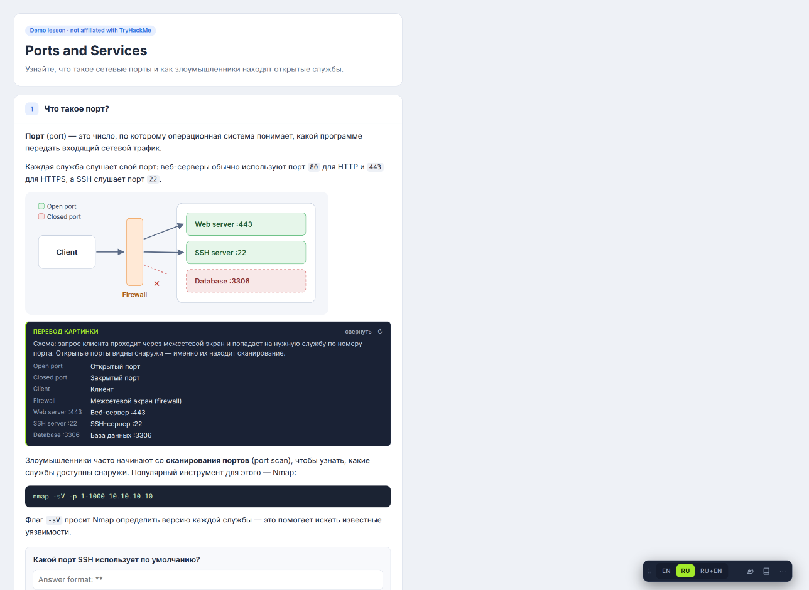
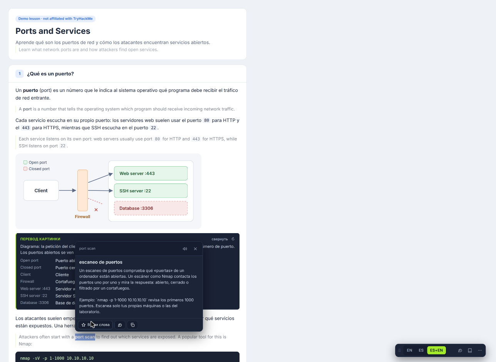
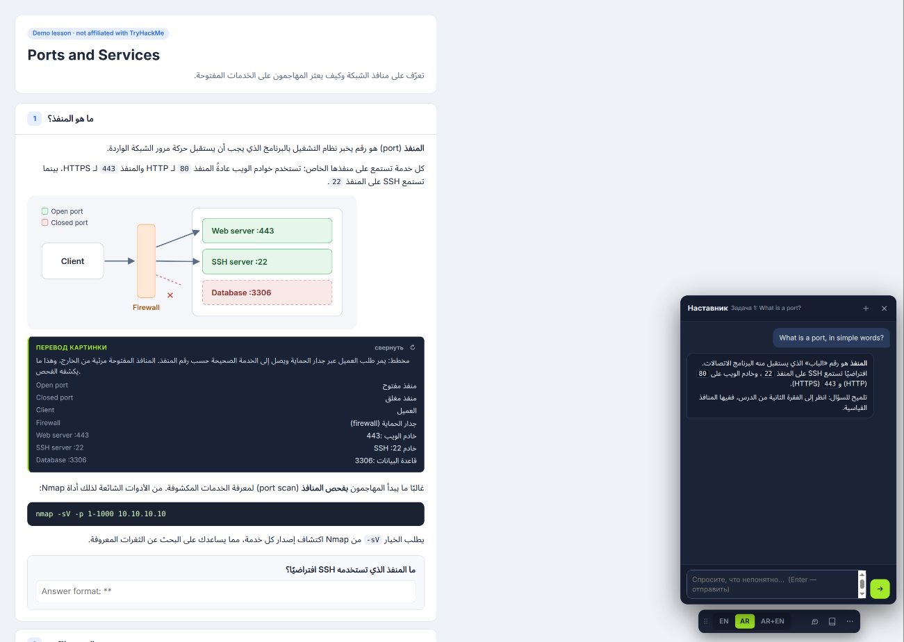
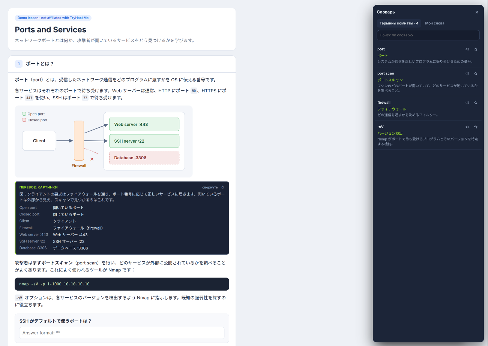
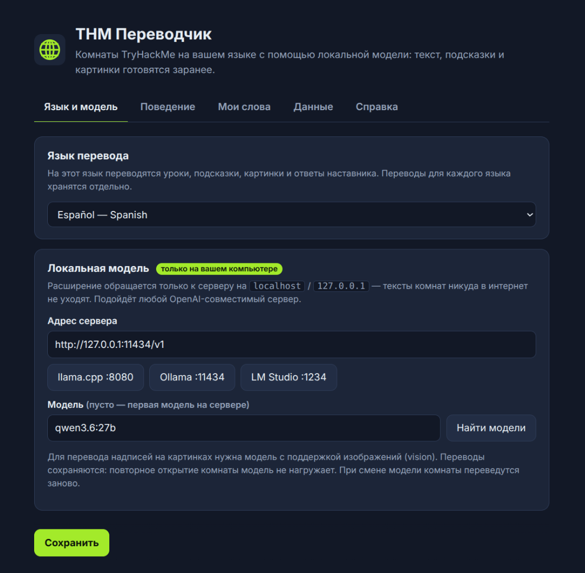

# THM Translator

Расширение Chrome, которое переводит комнаты [TryHackMe](https://tryhackme.com) на **45 языков** с помощью ИИ-модели, работающей **на вашем компьютере**. Уроки, вопросы, подсказки и даже надписи на картинках переводит ваша локальная модель, поэтому ничего не уходит в интернет.

[English](README.md) · **Русский**



## Возможности

- **Комната целиком.** Текст задач, заголовки, вопросы и подсказки переводятся прямо на странице. Есть три режима: оригинал, перевод, перевод с оригиналом под ним (<kbd>Alt+R</kbd> / <kbd>Alt+B</kbd>).
- **Картинки.** Надписи на скриншотах и схемах распознаются и переводятся, плюс короткое пояснение, что на картинке. Для этого нужна модель с поддержкой изображений (vision).
- **Объяснение выделенного.** Выделите слово, фразу или команду: появится перевод в контексте и объяснение простыми словами. Кнопка «Подробнее» даёт подробный разбор, слово можно сохранить в «Мои слова».
- **Словарь комнаты.** Важные термины собираются при переводе и используются дальше, поэтому перевод терминов остаётся единообразным.
- **Чат с наставником.** Видит открытую задачу и отвечает на выбранном языке. К вопросам задания сначала даёт наводку, а не ответ.
- **45 языков**, включая языки с письмом справа налево (арабский, персидский, иврит, урду) и китайский, японский, корейский.
- **Подготовка заранее.** При открытии комнаты вся она переводится в фоне, и при раскрытии задачи перевод уже готов. Переводы кэшируются для каждого языка: повторное открытие комнаты ничего не стоит.

## Только локальная модель

- В `host_permissions` есть только `tryhackme.com` и `localhost` / `127.0.0.1`. В коде нет облачных API, ключей, аналитики и внешних серверов.
- Запросы идут на OpenAI-совместимый `/v1/chat/completions` на вашем компьютере.
- Озвучка английских терминов использует только голоса, установленные в системе.

## Что нужно

- Chrome или другой браузер на Chromium (Manifest V3).
- Локальный OpenAI-совместимый сервер: [llama.cpp](https://github.com/ggml-org/llama.cpp) `llama-server` (`http://127.0.0.1:8080/v1`), [Ollama](https://ollama.com) (`http://127.0.0.1:11434/v1`), [LM Studio](https://lmstudio.ai) (`http://127.0.0.1:1234/v1`) или любой другой.
- Модель, которая хорошо пишет на нужном языке. Лучше всего работают серверы с поддержкой JSON-схемы (`response_format`); если сервер её не знает, расширение само повторит запрос без неё. Для картинок нужна vision-модель.

## Установка

1. Скачайте репозиторий (**Code → Download ZIP** или `git clone`) и распакуйте.
2. Откройте `chrome://extensions`, включите **Режим разработчика**, нажмите **Загрузить распакованное** и выберите папку.
3. Нажмите на значок расширения, откроются настройки:
   - выберите **язык перевода**;
   - выберите сервер (кнопки llama.cpp / Ollama / LM Studio) и нажмите **Найти модели**;
   - нажмите **Сохранить**, затем **Справка → Проверить подключение к модели**.
4. Откройте любую комнату TryHackMe: панель появится в правом нижнем углу.

```sh
# llama.cpp
llama-server -m your-model.gguf --port 8080

# Ollama (если запросы отклоняются с HTTP 403, разрешите расширения)
OLLAMA_ORIGINS="chrome-extension://*" ollama serve
```

## Симулятор: попробовать без TryHackMe

В папке `demo/` лежит демо-урок, на котором работает **настоящий** `content.js` с подменённым `chrome.*` и заранее записанными ответами модели на русском, испанском, арабском и японском. Модель и аккаунт TryHackMe не нужны.

```sh
python3 -m http.server 8000
# откройте http://127.0.0.1:8000/demo/
```

## Скриншоты

| | |
|---|---|
|  |  |
| Объяснение выделенного термина (испанский, перевод + оригинал) | Чат с наставником на арабском, справа налево |
|  |  |
| Словарь комнаты (японский) | Настройки: язык и локальный сервер |

## Замечания

- Интерфейс самого расширения пока на русском, а переводить можно на любой из 45 языков.
- Качество перевода зависит от модели. Если модель ломает формат, расширение делит запрос на части и повторяет.
- Независимый проект, не связан с TryHackMe. Используйте его для своего обучения и соблюдайте правила TryHackMe.

## Лицензия

[MIT](LICENSE)
